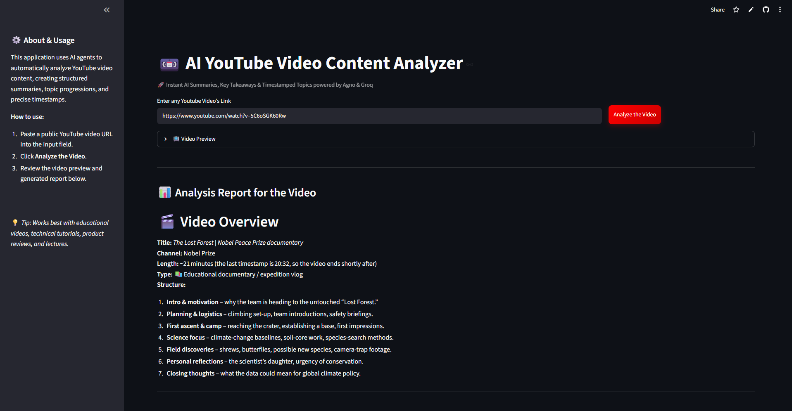

<p align="center">
  <h1 align="center">📼 AI YouTube Video Content Analyzer</h1>
  <p align="center">
    Drop a YouTube link. Get a structured breakdown with timestamps, key topics, and takeaways in seconds.
  </p>
  <p align="center">
    <a href="https://youtube-video-content-analyzer.streamlit.app/"></a>
  </p>
  <p align="center">
    Built with <a href="https://docs.agno.com/">Agno</a> · <a href="https://groq.com/">Groq</a> · <a href="https://streamlit.io/">Streamlit</a>
  </p>
  <p align="center">
    🌐 <strong>Live Demo:</strong> <a href="https://youtube-video-content-analyzer.streamlit.app/">youtube-video-content-analyzer.streamlit.app</a>
  </p>
</p>

<br/>

<p align="center">
  
</p>

---

## What It Does

This app takes any public YouTube video URL and uses an AI agent to produce a detailed analysis report containing:

- **Video overview** — type, structure, and length at a glance
- **Timestamped topic breakdown** — precise `[start, end, summary]` segments marking every major topic transition
- **Content categorization** — segments tagged by type (📚 Educational, 💻 Technical, 🎮 Gaming, 📱 Tech Review, 🎨 Creative)
- **Key learning points** — practical demonstrations and important references highlighted

You can watch the embedded video preview alongside the report and download the full analysis as a `.md` file.

---

## Why This Exists

Watching a 2-hour lecture to find the 3 minutes you actually need is painful. So is scrubbing through a tutorial trying to remember where that one demo was.

This tool reads the video transcript, understands the content structure, and gives you a clean, scannable report — so you can jump straight to what matters.

---

## Tech Stack

| Layer | Technology | Role |
| :--- | :--- | :--- |
| **AI Agent** | [Agno](https://docs.agno.com/) | Agent orchestration framework |
| **LLM** | [Groq](https://groq.com/) (`openai/gpt-oss-120b`) | Ultra-fast inference for analysis |
| **Transcript** | [youtube-transcript-api](https://github.com/jdepoix/youtube-transcript-api) | Extracts video captions/transcripts |
| **Frontend** | [Streamlit](https://streamlit.io/) | Interactive web UI |
| **Config** | [python-dotenv](https://github.com/theskumar/python-dotenv) | Secure API key management |

---

## Project Structure

```
AI_Youtube_Video_Content_Analyzer/
├── ui.py                  # Streamlit frontend — layout, styling, video preview, report display
├── youtube_analyzer.py    # AI agent definition — model config, tools, system prompt
├── requirements.txt       # Python dependencies
├── .env                   # API keys (not tracked in git)
├── .gitignore             # Excludes .env and __pycache__
└── assets/
    └── demo.png           # Demo screenshot for README
```

---

## Getting Started

### Prerequisites

- **Python 3.10+**
- A free **Groq API key** — get one at [console.groq.com](https://console.groq.com/)

### 1. Clone the repo

> 💡 **Try it online first:** You don't need to set up anything locally to test it. Try the live hosted app at [youtube-video-content-analyzer.streamlit.app](https://youtube-video-content-analyzer.streamlit.app/).

```bash
git clone https://github.com/sanjaynayak1224/AI_Youtube_Video_Content_Analyzer.git
cd AI_Youtube_Video_Content_Analyzer
```

### 2. Install dependencies

```bash
pip install -r requirements.txt
```

### 3. Set up your API key

Create a `.env` file in the project root:

```
GROQ_API_KEY=your_groq_api_key_here
```

### 4. Run the app

```bash
streamlit run ui.py
```

The app opens at `http://localhost:8501`. Paste a YouTube URL, hit **Analyze the Video**, and you're good to go.

---

## How It Works

```
YouTube URL  →  Transcript Extraction  →  AI Agent Analysis  →  Structured Report
                (youtube-transcript-api)    (Agno + Groq)         (Streamlit UI)
```

1. **You paste a YouTube link** into the input field.
2. **The Agno agent** uses `YouTubeTools` to pull the video transcript via `youtube-transcript-api`.
3. **Groq runs inference** on the transcript using a detailed system prompt that instructs the model to identify topics, create timestamps, and organize content.
4. **The report renders** in the Streamlit UI as formatted Markdown — with an option to download it.

The agent is cached using `@st.cache_resource` so the model loads once and stays in memory across interactions.

---

## Works Best With

- 🎓 University lectures and online courses
- 💻 Programming tutorials and tech walkthroughs
- 📱 Product reviews and unboxings
- 🎙️ Podcast episodes and interviews
- 📖 Conference talks and presentations

> **Note:** The video must have captions/subtitles available (auto-generated or manual). Videos without transcripts cannot be analyzed.

---

## Configuration

You can swap the underlying LLM model by passing a different `model_id` to `build_youtube_agent()`:

```python
# In youtube_analyzer.py
agent = build_youtube_agent(model_id="llama-3.3-70b-versatile")
```

Any model supported by [Groq's API](https://console.groq.com/docs/models) will work.

---

## Contributing

Contributions are welcome. If you want to add features, fix bugs, or improve the UI:

1. Fork the repository
2. Create a feature branch (`git checkout -b feature/your-feature`)
3. Commit your changes (`git commit -m "Add your feature"`)
4. Push to your branch (`git push origin feature/your-feature`)
5. Open a Pull Request

---

<p align="center">
  Built by <a href="https://github.com/sanjaynayak1224">Sanjay Nayak</a>
</p>
